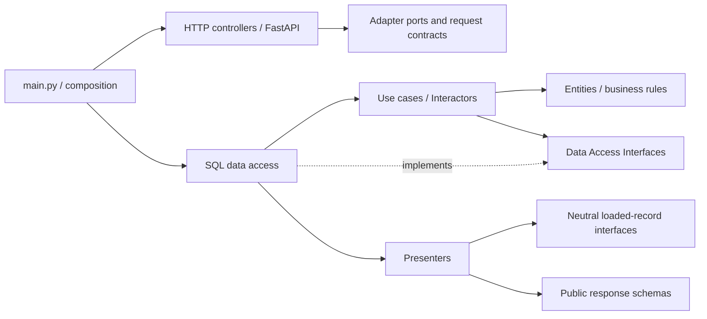
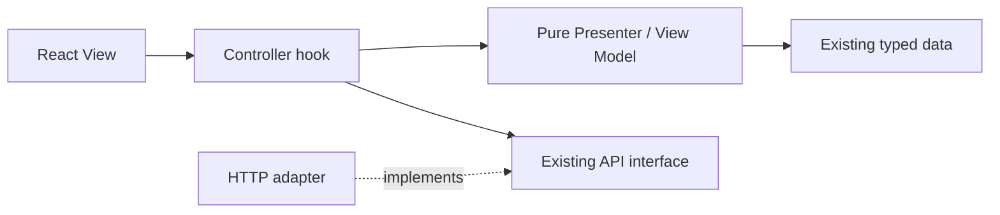
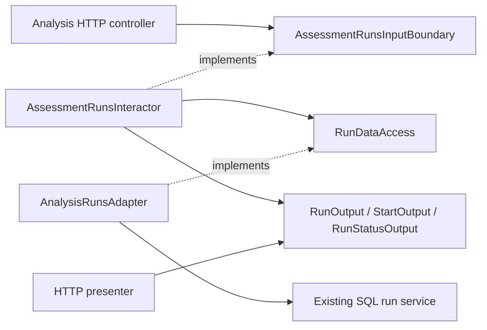

# Memoria architecture — #130

This is a behavior-preserving refactor. The screens, HTTP contracts, assessment
calculations, evidence rules and human decision gates retain their existing
behavior. It does not generate new assessments or approve real knowledge.

## Template assessment and Layer 2 integration

Layer 2 groups call evidence into pending drafts. The Manager flow approves independent
sources. Scoring checks the approved source version and excludes references derived
from the same conversation.

The scorer links requests, replies, and actions, then builds the same report for local
findings and saved Luna reviews. The backend checks citations and recalculates scores
before saving. Agents and Managers read that saved result.

Each metric uses `100 × (earned + unresolved / 2) / applicable` when evidence resolves
at least one part. Category weights combine the four unrounded metrics. A missing metric
leaves the overall score unavailable. Compact catalogue files expand to the original
check conditions, source requirements, and versions before scoring.

## Dependency rule

Business rules depend on ordinary Python values. Use cases depend on business
rules and small interfaces. HTTP, database and UI details depend on those rules,
not the other way around. `main.py` connects the implementations.



The dotted arrow represents implementation of an interface. SQL transactions
stay outside the use cases. An interactor calls a supplied repository; it does
not create a database connection. Presenters read already-loaded records through
structural interfaces and never issue queries.

## Files and diagram names

```text
backend/src/backend/
├── errors.py                # dependency-free shared application errors
├── entities/
│   ├── identity.py           # ownership and permissions
│   ├── results.py            # shared stored vocabulary and display mappings
│   ├── reviews.py            # review permission rule
│   ├── knowledge.py          # decision input, version and reference gates
│   ├── knowledge_import.py   # pipeline input/output and validation
│   ├── assessments.py        # assessment input/output, evidence and retry rules
│   └── scoring.py            # arithmetic and evidence validation
├── use_cases/
│   ├── record_review_decision.py  # input, result, repository, interactor
│   ├── knowledge.py          # decision/import Interactors + interfaces
│   ├── assessments.py        # AssessmentInteractor + Input Boundary
│   └── assessment_runs.py    # run commands/status, input and data-access boundaries
├── interface_adapters/
│   ├── ports.py              # existing read/HTTP-facing interfaces
│   ├── records.py            # loaded-record shapes, independent of ORM
│   ├── controllers/assessments.py  # schema parsing → pure validation
│   └── presenters/           # assessments, reviews, knowledge responses
├── frameworks/
│   ├── http/                 # request validation, authorization, delegation
│   ├── data_access/          # scoped SQL, locks, transactions, run lifecycle
│   └── database/
│       ├── session.py        # one engine/session factory per application
│       └── models/           # SQLAlchemy mapping
├── main.py                   # composition and resource lifetime
├── schemas/                  # unchanged public API contracts
├── data/                     # existing import/seed/CLI edges
└── api/, models/, providers/, services/, db/
                              # supported old imports and remaining edge helpers

ml/
├── entities.py               # stable assessment vocabulary
├── metric_categories/        # scoring catalogue and category templates
├── metrics/                  # template preparation, scoring and Luna reviews
└── abcd.py, references.py, citations.py, wording.py

frontend/src/
├── types/                    # existing API/data contracts
├── lib/httpApi.ts            # existing HTTP adapter
├── features/
│   ├── assessment-*/
│   │   ├── *Screen.tsx       # View: unchanged JSX and CSS
│   │   ├── controller.ts    # interaction state
│   │   └── presenter.ts     # pure View Model calculations
│   ├── entry/controller.ts
│   ├── conversations/controller.ts
│   └── knowledge-drafts/controller.ts
└── app/                      # routing, profile context, dependency composition
```

Input/Output Data are the existing typed values (`ReviewDecisionInput`,
`KnowledgeInput`, `ReviewDecisionResult`, `RunOutput`, `StartOutput`, `RunStatusOutput`,
`AnalysisRequest`, `ParsedReport`, `ImportResult`). Boundaries
are colocated with the use case that needs them. A separate file or class for
every diagram box would add indirection without changing the dependency rule.



## What was resolved

| Problem | Resolution | Proof |
|---|---|---|
| Database engine created from global settings | `create_app(settings)` owns its engine and session factory; shutdown disposes it | Two independent applications, request-scoped sessions, restart tests |
| Unit tests recreated PostgreSQL automatically | Only database fixtures request migrations | Core/boundary tests pass with an unreachable database URL |
| ORM, formatting and shared rules mixed in a large provider | Rules → entities; formatting → presenters; SQL → data access | Inward import tests; presenters load with SQLAlchemy blocked |
| Review rules embedded in persistence | RecordReviewDecision and neutral inputs; locks/commit remain in repository | Idempotency, conflicting/concurrent decisions, ownership tests |
| Knowledge eligibility mixed with writes | Pure draft state validation, injected transaction repository | Version, reference, permission, conflict/duplicate and visibility tests |
| Assessment generation coupled to storage | Injected generation/parsing/validation; storage remains a transaction edge | Optional-engine startup, invalid report, retry and persistence tests |
| Knowledge pipeline execution mixed with validation | Injected pipeline; pure validation; existing transactional import | Idempotency, source counts, failure and concurrency tests |
| Assessment screens mix display derivation with interaction | Pure presenters and controller hooks, unchanged views | Existing frontend tests, JSX/asset comparison and browser screenshots |

## Preserved boundaries and deliberate exclusions

- Public read ports continue to use API projection schemas. They are adapter
  contracts, not business-use-case inputs; duplicating every read DTO adds no
  useful separation. Presenters import neither SQLAlchemy nor ORM models.
- Repository implementations retain SQL-specific locking, eager loading,
  uniqueness handling and transactions. Policy decisions use the inner rules.
- Existing API schema modules and import/seed scripts keep their established
  paths. Old model/service/provider imports are compatibility aliases, not
  duplicate implementations. Removing those aliases belongs in a later,
  explicitly breaking cleanup.
- Existing focused review-queue, evidence and small form components remain
  components. React interaction is a valid View/Controller responsibility;
  extraction was limited to actual mixed responsibilities.
- `core/config.py`, `core/database.py`, `services/clock.py`, narration and CLI
  utilities are execution edges despite their legacy paths. Business layers
  cannot import them. Renaming every leaf is not necessary for the diagram.
- Analysis and knowledge extraction remain optional injected capabilities.
  This branch does not import #122's scoring engine or #129's generator, change
  any rule/prompt versions, or fill missing evidence.
- Import guards cover business layers, ML helpers and presenters. They are not a
  claim that every possible dynamic import or future dependency is proven safe.

## Preserved behavior

Agent access remains limited to assigned conversations in the same organization.
A Manager decision is a separate record and never rewrites the automatic result.
Knowledge approval still requires the stored reference, current content version,
capability and conflict/duplicate checks. Rejection still requires a reason.
Pending knowledge remains hidden from Agents. Scores, citations and missing
facts are read unchanged; unavailable engines fail visibly rather than fabricate
assessments. No new database migration is required by this refactor.

## Completed review corrections

- Review input validation is independent of HTTP and SQL. Both the Pydantic HTTP
  schema and RecordReviewDecision call it. An invalid corrected decision cannot
  reach a repository, even through a non-HTTP caller. Existing 422 behavior,
  whitespace normalization and text bounds remain intact.
- ReviewDecisionRepository returns immutable ReviewDecisionResult, never an arbitrary generic
  value or ORM record. The presenter formats that output. The compatibility
  formatter for already-loaded records remains available outside the core.
- The review route calls the interactor with a scoped SQL repository. SQL data
  access does not construct the interactor. Existing read and write provider
  ports are checked against their database adapters; simple identity response
  mapping lives in a presenter.
- Analysis routes depend on AssessmentRunsInputBoundary. The interactor
  coordinates start/status and returns neutral records. AnalysisRunsAdapter
  converts the legacy SQL service's results at the outer boundary. Existing
  direct AnalysisService callers retain their API and transaction behavior.
- The internal assessment execution boundary is used by its caller. Output
  boundaries use typed return values rather than adding presenter callbacks;
  this retains dependency inversion with less wiring.
- Guards resolve relative imports, recognize common import aliases, reject
  dynamic-import escapes and flag file/environment/network/clock access. Tests
  intentionally introduce violations to prove rejection.


